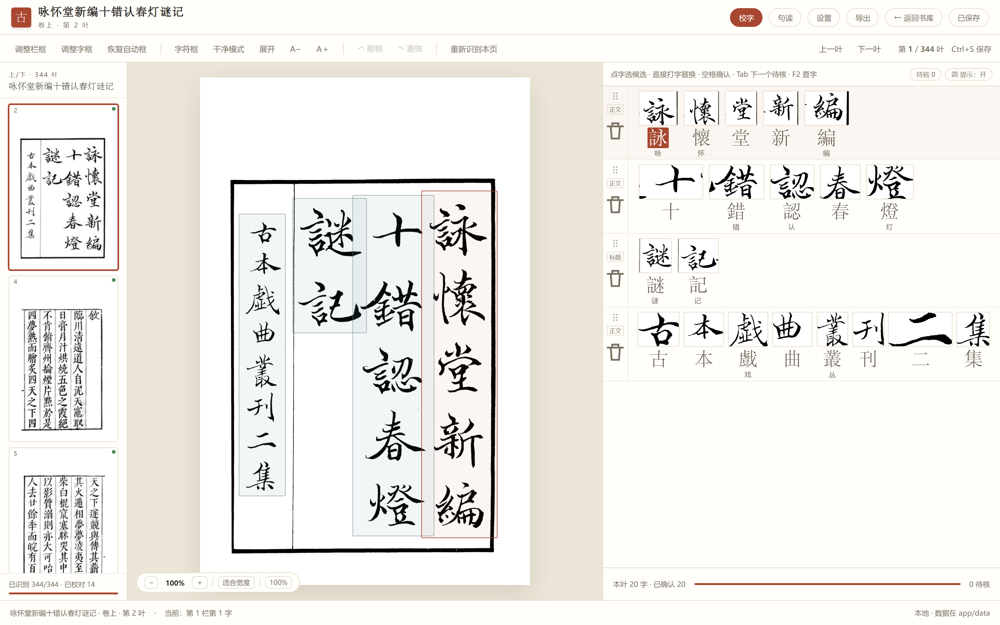
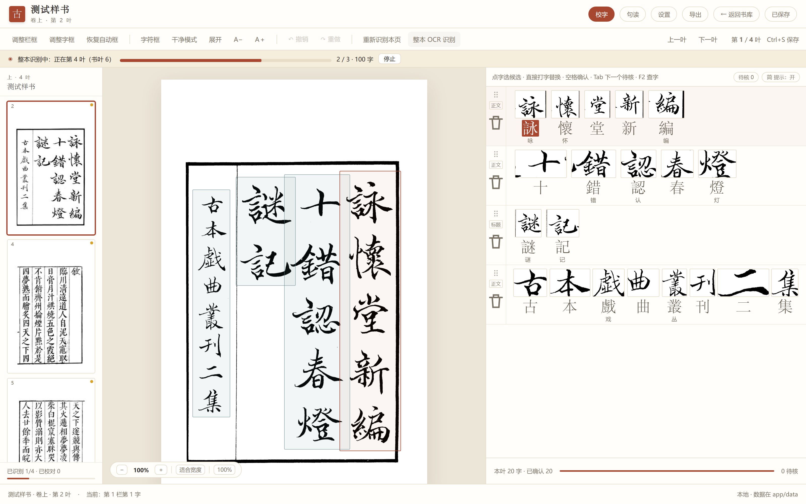
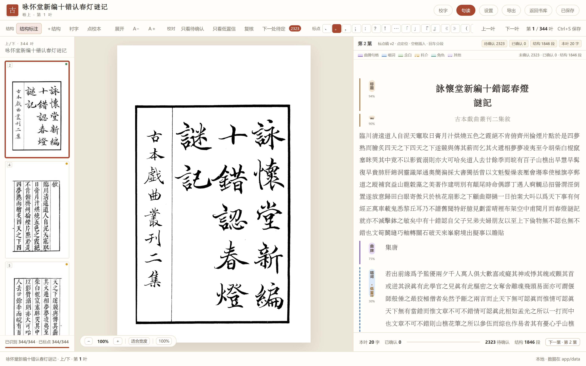

# 古籍整理工作台（GuWen）

[](LICENSE)

面向古籍扫描本的本地整理工具：**图片导入 → 整本 OCR → 校字 → 结构识别 → AI 句读 → 点校本 DOCX 导出**。

仓库地址：<https://github.com/kokoroyi/GuWen>

本仓库是可直接使用的**干净源码版**：

- 不含便携 Python、PaddleOCR 模型、llama.cpp 运行时或任何 `.gguf` 模型；
- 不启动本地大模型服务；
- AI 句读通过任意 **OpenAI 兼容接口** 接入，模型、`reasoning_effort`（思考强度）、温度和供应商私有参数都在页面里配置。

> 图片和书稿只在本机处理；句读时会把正文发送到你配置的 AI 接口。

## 界面预览

| 校字台：逐字对位、候选字、框调整 | 整本 OCR：进度与停止 |
|---|---|
|  |  |



> 配图为最终版界面截图；本仓库将「设置」中的本地模型配置改成了 OpenAI 兼容接口配置。

## 功能

- **整本 OCR**：PaddleOCR `PP-OCRv6_small_det` + `PP-OCRv6_medium_rec`，按栏识别、逐字切框。
- **校字台**：候选字、查字、繁简提示、框调整、局部重识别、跨页撤销。
- **结构引擎 `structure-new-v1`**：标题 / 副题 / 卷名 / 齣名 / 曲牌 / 唱词 / 念白 / 科介 / 角色。
- **AI 句读**：规则结构 + 按结构逐块调用 OpenAI 兼容模型，保字重建、置信度与纯度审计。
- **点校本**：人工精校、接受/拒绝、历史快照、局部重标、DOCX 导出。
- **数据本地化**：JSON 书稿 + 原图路径；备份不复制原图。

## 环境要求

- Python **3.11–3.12**（推荐 3.12；numpy 2.3 需要 3.11+）
- Windows 10/11 推荐；macOS/Linux 可运行，但系统“浏览文件夹”按钮仅 Windows 可用，其他系统直接粘贴图片文件夹路径即可
- 首次安装依赖、首次 OCR 需要网络（PaddleOCR 会下载 PP-OCRv6 模型到用户缓存目录）
- 一个可用的 OpenAI 兼容 AI 接口（也可以指向你自己已经启动的 Ollama / vLLM / LM Studio，但本应用**不负责启动它**）

## 下载

- **源码**：当前仓库（`main` 分支）。
- **Windows 启动器版**：到 [Releases](https://github.com/kokoroyi/GuWen/releases) 下载 `GuWen-v1.0.2-Windows-Launcher.zip`。压缩包包含源码、`setup.bat`、`GuWen.exe` 托盘启动器和说明文档，不包含 Python、OCR 模型或大模型。

## 快速开始

### Windows：EXE 托盘启动器（推荐）

1. 解压后双击 `setup.bat`，等待 Python 依赖安装完成（首次会创建 `.venv`）。
2. 双击 `GuWen.exe`。
3. 托盘图标出现后会自动打开 <http://127.0.0.1:8770/>。

托盘右键菜单：

```text
打开工作台 / 打开数据目录 / 打开日志 / 安装依赖（首次使用） / 退出 GuWen
```

`GuWen.exe` 只启动本地 FastAPI 服务，**不会启动本地大模型**；AI 句读仍走网页里配置的 OpenAI 兼容接口。详细步骤见 [docs/Windows启动器版说明.md](docs/Windows启动器版说明.md)。

### Windows：命令行启动

```bat
setup.bat
start.bat
```

然后打开 <http://127.0.0.1:8770/>。

### macOS / Linux

```bash
./setup.sh
./start.sh
```

也可以手动启动：

```bash
python -m venv .venv
# Windows: .venv\Scripts\activate
# macOS/Linux: source .venv/bin/activate
pip install -r requirements.txt
python run.py
```

### 不用启动脚本

```bash
python app/server.py
```

浏览器打开 <http://127.0.0.1:8770/>。端口可用环境变量改：`GUWEN_PORT=8780 python app/server.py`。

## 配置 AI 接口

首页右上角 **AI 设置**，或进入任意一本书后点顶栏 **设置**：

| 字段 | 说明 |
|---|---|
| 接口地址 | OpenAI 兼容 Base URL，填到 `/v1` 即可，例如 `https://api.openai.com/v1` |
| API Key | 只保存在本机 `app/data/settings.json`；无鉴权的本地兼容服务可留空 |
| 模型 | 点 **获取模型** 从 `/models` 拉取，也可以直接手填模型 ID |
| 思考强度 | 按标准字段 `reasoning_effort` 发送：none / minimal / low / medium / high；默认不发送 |
| 采样温度 | 留空使用服务端默认；古籍标点建议 `0`。部分推理模型只接受默认温度 |
| 请求超时 | 默认 600 秒；整本句读可能较慢，按需调大 |
| 额外参数 | JSON 对象，合并进请求体。用于适配 DeepSeek / Qwen / GLM 等供应商自己的思考开关 |

保存后点 **测试连接** 会发一次最小 chat 请求，确认地址、密钥和模型都可用。

### 常见接口示例

| 服务 | Base URL | 模型示例 |
|---|---|---|
| OpenAI | `https://api.openai.com/v1` | 以账号可用模型为准 |
| DeepSeek | `https://api.deepseek.com/v1` | `deepseek-chat` |
| 阿里云百炼（兼容模式） | `https://dashscope.aliyuncs.com/compatible-mode/v1` | `qwen-plus` 等 |
| Ollama（已自行启动） | `http://127.0.0.1:11434/v1` | `qwen3` 等 |
| vLLM / LM Studio | 以服务实际地址为准，通常以 `/v1` 结尾 | 服务加载的模型名 |

不同供应商对 `reasoning_effort`、`max_tokens`、温度和思考开关的支持不一样。遇到 400 时：

1. 先在 **AI 设置** 里把思考强度改为“不发送”，温度留空，再测试；
2. 仍报参数错误，把供应商要求的字段填进 **额外参数 JSON**；
3. 详见 [docs/AI接口配置.md](docs/AI接口配置.md)。

## 使用流程

```text
导入图片文件夹
  → 校字台：整本 OCR 识别（全流程一次）
  → 人工校对
  → 句读台：结构生成 + 按结构 AI 句读（全流程一次）
  → 人工精校
  → 点校本视图 / 导出 DOCX
```

整本操作只有两处：**整本 OCR** 和 **句读整本初版**，各执行一次；之后只对选定结构做局部 AI 标点。

## OCR 模型

仓库不包含模型文件。首次执行 OCR 时 PaddleOCR / PaddleX 会自动下载：

- `PP-OCRv6_small_det`
- `PP-OCRv6_medium_rec`

默认缓存到用户目录（Windows 通常在 `C:\Users\<你>\.paddlex\`）。离线机器请先在有网机器上完成一次 OCR，把缓存目录复制过去，或按 PaddleOCR 文档配置本地模型目录。

## 数据与隐私

| 内容 | 位置 | 是否上传 |
|---|---|---|
| 原始扫描图片 | 你导入的文件夹（应用只记录路径） | 否 |
| OCR / 校字 / 标点稿 | `app/data/books/<id>/` | 否 |
| 设置（含 API Key） | `app/data/settings.json` | 否 |
| 句读正文 | 发给你配置的 AI 接口 | 是 |
| 本仓库 | GitHub | 不含任何书稿、密钥或模型 |

- `app/data/settings.json`、`app/data/books/` 等已在 `.gitignore` 中排除。
- API Key 以明文保存在本机设置文件里；这是单机工具，请勿把 `settings.json` 提交到公开仓库。
- 书库备份只备份 JSON，不含原图；换机仍需原图片文件夹。

## 目录结构

```text
app/
├─ server.py          FastAPI 服务与 /api/*
├─ pipeline.py        PaddleOCR 流水线
├─ store.py           书库/设置 JSON 存储
├─ punctgen.py        规则结构、句格、页范围
├─ structure_new.py   structure-new-v1 结构引擎
├─ llm_punct.py       句读提示词、保字重建、置信/审计
├─ llm_client.py      OpenAI 兼容客户端（本仓库新增）
├─ charlib.py         离线查字数据层
├─ pick_folder.ps1    Windows 文件夹选择框
├─ static/            前端（原生 HTML/CSS/JS，无构建步骤）
└─ data/
   ├─ chardata/       查字索引（随仓库提供）
   └─ qupai/          曲牌句格与模型数据（随仓库提供）
docs/
├─ images/            README 界面配图
├─ AI接口配置.md
└─ 架构说明.md
launcher/
├─ TrayLauncher.cs    Windows 托盘启动器源码
├─ GuWen.exe          托盘启动器成品
└─ build.bat          重新编译
run.py                启动入口（自动打开浏览器）
requirements.txt
setup.bat / start.bat
setup.sh / start.sh
```

## 已知限制

- 系统文件夹选择框仅 Windows；其他平台手动粘贴路径。
- 整本 OCR 和句读是单机单任务、内存状态；服务重启会丢失运行中的任务进度（句读有 checkpoint，可续跑）。
- 首次 OCR 需下载模型，且 PaddleOCR 在 CPU 上较慢；开发阶段用 344 页测试书跑通过全流程。
- 初版句读仍可能有失败块 / 未标点块，界面会标记，需要人工或局部 AI 补。
- 没有自动化 E2E；修改后请手工回归导入、OCR、句读、导出。

## 开发

```bash
# 直接用开发环境运行
python app/server.py

# 或
python run.py
```

接口说明见 [docs/架构说明.md](docs/架构说明.md)。AI 请求只使用标准 `POST /chat/completions` 和 `GET /models`，不依赖任何供应商 SDK。

## 许可证

本项目采用 [MIT License](LICENSE) 开源，Copyright (c) 2026 kokoroyi。
